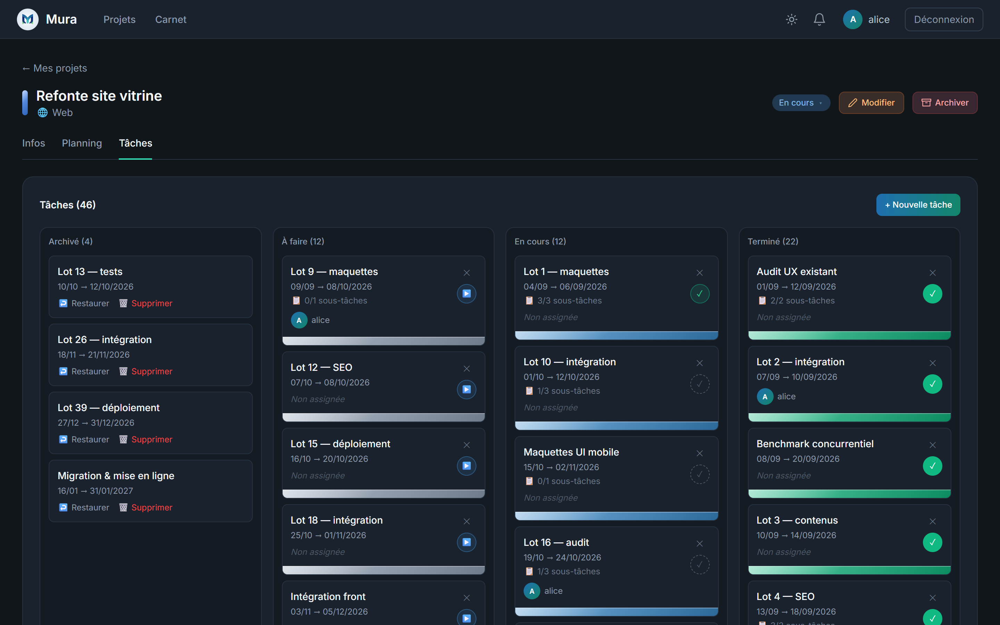
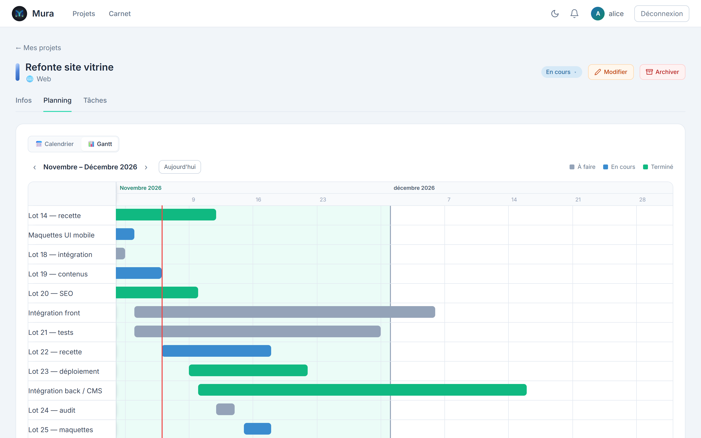

<p align="center">
  <picture>
    <source media="(prefers-color-scheme: dark)" srcset="frontend/src/assets/logo-on-dark.png">
    
  </picture>
</p>

<h1 align="center">Mura</h1>

<p align="center">
  La gestion de projet en équipe, installée sur votre propre serveur.<br>
  Les projets, les tâches, le planning et les personnes qui y travaillent — vos données restent chez vous.
</p>

<p align="center">
  🌐 <a href="https://mura.novadev-studio.fr">mura.novadev-studio.fr</a>
  &nbsp;·&nbsp;
  <a href="README.md">English</a> | <strong>Français</strong>
</p>

<p align="center">
  
  
  
  
</p>



## ✨ Fonctionnalités

- 📁 **Projets** — un type, une couleur, une date de début et un statut (*à venir*, *en cours*, *achevé*). Un projet terminé s'archive, puis passe par une corbeille avant d'être supprimé.
- ✅ **Tâches** — classées par statut, chacune avec ses dates, un responsable, des sous-tâches et l'historique de ses changements de statut.
- 📅 **Planning** — toutes les tâches sur un calendrier mensuel ou sur un diagramme de Gantt.
- 👥 **Équipes** — on rejoint un projet sur invitation, valable 14 jours. Chaque membre est propriétaire, administrateur ou membre, et la propriété peut être cédée.
- 🧑‍🤝‍🧑 **Groupes** — des équipes de personnes menées par un gérant, ajoutées d'un coup à un projet.
- 📇 **Carnet** — le carnet d'adresses des personnes avec qui vous travaillez : favoris, demandes de contact, et suggestions au fil de la saisie quand vous invitez quelqu'un.
- 🔔 **Notifications** — dans la cloche et par e-mail : quelqu'un rejoint ou quitte vos projets et vos groupes, demande à entrer dans votre carnet, ou voit son compte suspendu ou supprimé. Les invitations arrivent aussi par e-mail.
- 🛠️ **Administration** — les comptes (rôles, suspension, suppression), les types de projet proposés, et tous les groupes.
- 🔒 **Vos données** — chacun peut récupérer tout ce que Mura conserve sur lui, ou supprimer son compte. Les pages de mentions légales et de politique de confidentialité sont remplies par la personne qui gère l'instance.
- 🌗 **Thèmes sombre et clair**, mémorisés sur chaque appareil.



Mura est fait pour être installé par ceux qui l'utilisent : chaque instance appartient à la personne qui la gère, et personne d'autre ne voit ce qu'on y met. L'inscription vérifie chaque adresse par e-mail, les tentatives de connexion sont limitées, et le HTTPS tient en une ligne de configuration.

## 🚀 Installation

Mura tourne avec Docker, sur votre propre machine ou sur un serveur.

### Prérequis

- [Docker](https://www.docker.com/) avec Docker Compose 2.24 ou plus récent
- Un compte e-mail capable d'envoyer par SMTP : l'inscription vérifie chaque adresse avec un code envoyé par e-mail
- Pour une instance utilisée par d'autres personnes : un nom de domaine qui pointe vers le serveur, pour le HTTPS

### Installer

```bash
git clone https://github.com/mdeguil/mura.git
cd mura
cp .env.example .env
```

Remplissez ensuite `.env` **avant le premier lancement** — chaque réglage y est expliqué (en anglais) :

- `JWT_SECRET` : une valeur aléatoire, par exemple obtenue avec `openssl rand -base64 48`. Le backend refuse de démarrer sans elle.
- `POSTGRES_PASSWORD` et `SPRING_DATASOURCE_PASSWORD` : le même nouveau mot de passe, à la place de `changeme`. La base de données garde le mot de passe avec lequel elle a été créée, au premier lancement.
- `MURA_URL` : l'adresse que les gens taperont, par exemple `https://mura.example.org`.
- `MURA_ADMIN_EMAIL` : votre propre adresse. Le compte que vous créez avec elle devient l'administrateur.
- `MAIL_HOST`, `MAIL_PORT`, `MAIL_USERNAME`, `MAIL_PASSWORD`, `MAIL_STARTTLS` et `MURA_MAIL_FROM` : les réglages SMTP de votre fournisseur d'e-mails.

Lancez Mura :

```bash
docker compose up -d --build
docker compose logs backend
```

Le log doit afficher `Mail server … answered`. Ouvrez `MURA_URL` (http://localhost:5173 si vous l'avez laissée vide), créez votre compte avec `MURA_ADMIN_EMAIL` et saisissez le code reçu : vous êtes l'administrateur.

Si le log affiche `password authentication failed for user "mura"`, la base de données a été créée lors d'un lancement précédent, avec un autre mot de passe. Sur une installation neuve qui ne contient encore rien, repartez de zéro avec `docker compose down -v` puis `docker compose up -d` — `-v` efface la base. Sur une instance déjà utilisée, changez plutôt le mot de passe, comme l'indique [docs/setup.md](docs/setup.md#useful-commands).

Ensuite :

- **Le HTTPS**, indispensable dès que d'autres personnes utilisent l'instance : [docs/https.md](docs/https.md)
- **Les sauvegardes et les mises à jour** : [docs/sauvegarde.md](docs/sauvegarde.md)
- **Tous les réglages, et travailler sur Mura lui-même** : [docs/setup.md](docs/setup.md) (en anglais)

## 🏗️ Architecture

| Partie | Technologies | Dossier |
| :--- | :--- | :--- |
| API | Spring Boot 3, Java 21, Spring Security avec JWT, JPA, Flyway | `backend/` |
| Base de données | PostgreSQL 15, son schéma construit par les migrations Flyway | `backend/src/main/resources/db/migration/` |
| Interface | React 18, TypeScript strict, Vite, Tailwind CSS, Zustand, servie par nginx | `frontend/` |
| HTTPS | Caddy, facultatif, devant le frontend | `caddy/`, `docker-compose.https.yml` |

Le navigateur ne parle qu'au frontend : nginx transmet `/api` au backend, qui n'est jamais exposé seul. [docs/guide-du-code.md](docs/guide-du-code.md) explique comment le code est organisé et les règles qu'il suit.

## 🤝 Contribuer

Les contributions sont les bienvenues ! Lisez [CONTRIBUTING.md](CONTRIBUTING.md) avant de proposer une pull request.

## 📄 Licence

Mura peut être installé et utilisé librement, pour vous-même ou au sein de votre organisation, mais son code ne peut être ni modifié, ni redistribué, ni vendu sans l'accord de son auteur — voir le fichier [LICENSE](LICENSE) pour les conditions exactes. Les versions publiées avant cette licence restent sous licence MIT.
