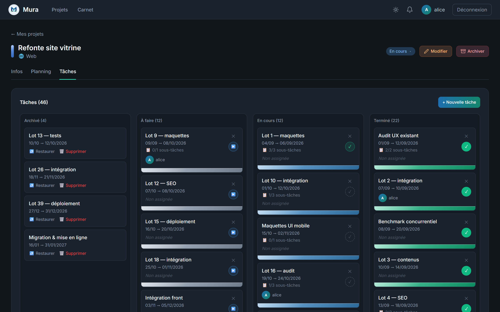
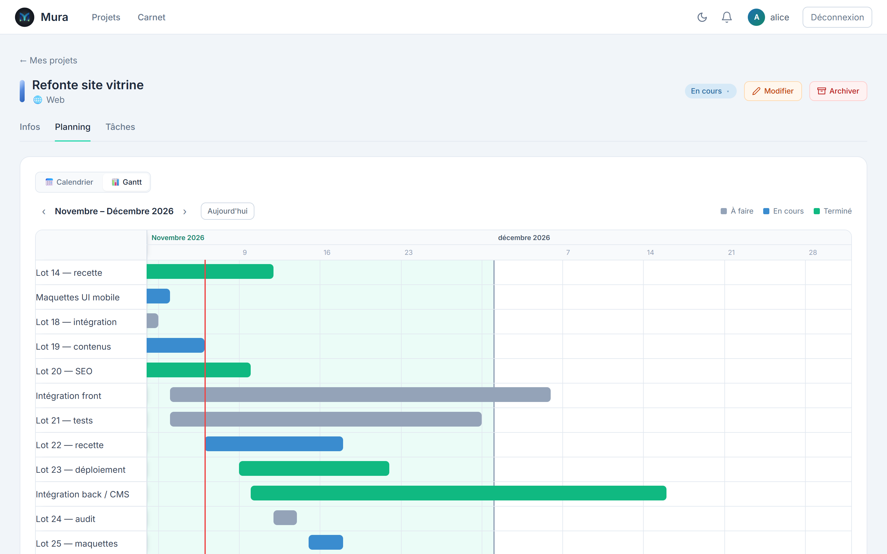

<p align="center">
  <picture>
    <source media="(prefers-color-scheme: dark)" srcset="frontend/src/assets/logo-on-dark.png">
    
  </picture>
</p>

<h1 align="center">Mura</h1>

<p align="center">
  Project management for teams, installed on your own server.<br>
  Projects, tasks, planning and the people who work on them — your data stays with you.
</p>

<p align="center">
  🌐 <a href="https://mura.novadev-studio.fr">mura.novadev-studio.fr</a>
  &nbsp;·&nbsp;
  <strong>English</strong> | <a href="README.fr.md">Français</a>
</p>

<p align="center">
  
  
  
  
</p>



## ✨ Features

The interface is in French.

- 📁 **Projects** — a type, a colour, a start date and a status (*à venir*, *en cours*, *achevé*). Finished work is archived, then goes to a bin before it is deleted.
- ✅ **Tasks** — sorted by status, each with its dates, a person in charge, subtasks and the history of its status changes.
- 📅 **Planning** — every task on a month calendar or on a Gantt chart.
- 👥 **Teams** — people join a project by invitation, which expires after 14 days. Each member is owner, administrator or member; ownership can be handed over.
- 🧑‍🤝‍🧑 **Groups** — teams of people run by a *gérant*, brought into a project in one go.
- 📇 **Carnet** — an address book of the people you work with: favourites, contact requests, and suggestions as you type when inviting.
- 🔔 **Notifications** — in the bell and by e-mail: someone joins or leaves your projects and groups, asks to be in your carnet, or has their account suspended or deleted. Invitations arrive by e-mail too.
- 🛠️ **Administration** — accounts (roles, suspension, deletion), the project types on offer, and every group.
- 🔒 **Your data** — each person can export everything Mura holds about them, or delete their account. Legal notice and privacy policy pages are filled in by whoever runs the instance.
- 🌗 **Dark and light themes**, remembered on each device.



Mura is made to be installed by the people who use it: each instance belongs to whoever runs it, and nobody else sees what is put in it. Sign-up confirms every address by e-mail, sign-ins are rate-limited, and HTTPS takes one line of configuration.

## 🚀 Getting Started

Mura runs with Docker, on your own machine or on a server.

### Prerequisites

- [Docker](https://www.docker.com/) with Docker Compose 2.24 or later
- A mail account that can send through SMTP: sign-up confirms every address with a code sent by e-mail
- For an instance other people use: a domain name pointing at the server, for HTTPS

### Install

```bash
git clone https://github.com/mdeguil/mura.git
cd mura
cp .env.example .env
```

Then fill in `.env` **before the first start** — each setting is explained there:

- `JWT_SECRET`: a random value, for example from `openssl rand -base64 48`. The backend refuses to start without one.
- `POSTGRES_PASSWORD` and `SPRING_DATASOURCE_PASSWORD`: the same new password, in place of `changeme`. The database keeps the password it was created with, at the first start.
- `MURA_URL`: the address people will type, for example `https://mura.example.org`.
- `MURA_ADMIN_EMAIL`: your own address. The account you create with it becomes the administrator.
- `MAIL_HOST`, `MAIL_PORT`, `MAIL_USERNAME`, `MAIL_PASSWORD`, `MAIL_STARTTLS` and `MURA_MAIL_FROM`: your mail provider's SMTP settings.

Start Mura:

```bash
docker compose up -d --build
docker compose logs backend
```

The log should say `Mail server … answered`. Open `MURA_URL` (http://localhost:5173 if left empty), create your account with `MURA_ADMIN_EMAIL` and enter the code you receive: you are the administrator.

If the log says `password authentication failed for user "mura"`, the database was created at an earlier start, with another password. On a new install that holds nothing yet, start it over with `docker compose down -v` then `docker compose up -d` — `-v` erases the database. On an instance in use, change the password instead, as [docs/setup.md](docs/setup.md#useful-commands) shows.

Then:

- **HTTPS**, needed as soon as other people use the instance: [docs/https.md](docs/https.md)
- **Backups and updates**: [docs/sauvegarde.md](docs/sauvegarde.md)
- **Every setting, and working on Mura itself**: [docs/setup.md](docs/setup.md)

## 🏗️ Architecture

| Part | Technologies | Folder |
| :--- | :--- | :--- |
| API | Spring Boot 3, Java 21, Spring Security with JWT, JPA, Flyway | `backend/` |
| Database | PostgreSQL 15, its schema built by the Flyway migrations | `backend/src/main/resources/db/migration/` |
| Interface | React 18, strict TypeScript, Vite, Tailwind CSS, Zustand, served by nginx | `frontend/` |
| HTTPS | Caddy, optional, in front of the frontend | `caddy/`, `docker-compose.https.yml` |

The browser only ever talks to the frontend: nginx forwards `/api` to the backend, which is not exposed on its own. [docs/guide-du-code.md](docs/guide-du-code.md) (in French) explains how the code is organised and the conventions it follows.

## 🤝 Contributing

Contributions are welcome! Please read [CONTRIBUTING.md](CONTRIBUTING.md) before submitting a PR.

## 📄 License

Mura is free to install and use, for yourself or within your organisation, but its code may not be modified, redistributed or sold without the author's permission — see the [LICENSE](LICENSE) file (in French) for the exact terms. Versions published before this licence remain under the MIT License.
